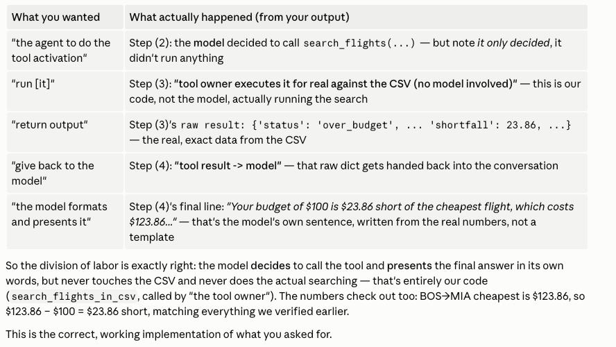

# Possible Flight Combinations (from `flights.csv`)

Every real, non-cancelled route in the dataset (161 of 188 total rows are non-cancelled). Use these origin/destination pairs and a budget at or above "Min Price" when testing `experiment/run_experiment.py` to get a real match.

| Origin | Destination | Flights | Min Price | Max Price | Airlines |
|---|---|---|---|---|---|
| BOS (Boston) | MIA (Miami) | 6 | $123.86 | $574.61 | Delta, Southwest |
| BOS (Boston) | PHX (Phoenix) | 6 | $60.10 | $165.41 | Delta, United |
| DEN (Denver) | MCO (Orlando) | 2 | $108.73 | $629.66 | American, Delta |
| DEN (Denver) | MIA (Miami) | 3 | $532.78 | $532.78 | Delta |
| DEN (Denver) | ORD (Chicago (O'Hare)) | 3 | $289.44 | $289.44 | United |
| DEN (Denver) | SFO (San Francisco) | 2 | $121.14 | $142.15 | American |
| DFW (Dallas/Fort Worth) | BOS (Boston) | 3 | $547.01 | $547.01 | Delta |
| DFW (Dallas/Fort Worth) | DEN (Denver) | 4 | $220.25 | $381.16 | American, United |
| DFW (Dallas/Fort Worth) | JFK (New York (JFK)) | 3 | $437.26 | $437.26 | United |
| DFW (Dallas/Fort Worth) | LAX (Los Angeles) | 4 | $96.01 | $130.41 | American, Southwest, United |
| DFW (Dallas/Fort Worth) | MIA (Miami) | 4 | $330.41 | $515.17 | Delta, Southwest |
| DFW (Dallas/Fort Worth) | PHX (Phoenix) | 4 | $171.05 | $563.58 | JetBlue |
| DFW (Dallas/Fort Worth) | SFO (San Francisco) | 1 | $198.81 | $198.81 | Delta |
| JFK (New York (JFK)) | BOS (Boston) | 9 | $419.04 | $595.34 | Delta, JetBlue, United |
| JFK (New York (JFK)) | DEN (Denver) | 2 | $425.43 | $425.43 | Delta |
| JFK (New York (JFK)) | LAX (Los Angeles) | 2 | $375.32 | $524.10 | Delta, United |
| JFK (New York (JFK)) | MIA (Miami) | 3 | $133.42 | $133.42 | JetBlue |
| JFK (New York (JFK)) | ORD (Chicago (O'Hare)) | 1 | $572.76 | $572.76 | American |
| JFK (New York (JFK)) | SFO (San Francisco) | 5 | $183.76 | $543.08 | American, Delta, United |
| LAX (Los Angeles) | BOS (Boston) | 4 | $211.23 | $623.51 | American, Delta, United |
| LAX (Los Angeles) | DEN (Denver) | 1 | $390.87 | $390.87 | Delta |
| LAX (Los Angeles) | MCO (Orlando) | 5 | $50.77 | $550.04 | Delta, United |
| LAX (Los Angeles) | MIA (Miami) | 3 | $161.76 | $161.76 | Delta |
| LAX (Los Angeles) | PHX (Phoenix) | 4 | $54.78 | $322.09 | Delta, JetBlue |
| LAX (Los Angeles) | SFO (San Francisco) | 3 | $467.24 | $622.64 | Delta |
| MCO (Orlando) | DFW (Dallas/Fort Worth) | 3 | $198.12 | $598.74 | Delta, United |
| MCO (Orlando) | JFK (New York (JFK)) | 1 | $571.21 | $571.21 | Southwest |
| MCO (Orlando) | LAX (Los Angeles) | 3 | $550.81 | $550.81 | Delta |
| MCO (Orlando) | MIA (Miami) | 4 | $309.28 | $312.42 | Delta, JetBlue |
| MIA (Miami) | BOS (Boston) | 6 | $59.73 | $432.22 | American, United |
| MIA (Miami) | DFW (Dallas/Fort Worth) | 1 | $570.83 | $570.83 | JetBlue |
| MIA (Miami) | MCO (Orlando) | 1 | $150.36 | $150.36 | Delta |
| MIA (Miami) | ORD (Chicago (O'Hare)) | 4 | $251.57 | $463.66 | American, JetBlue |
| MIA (Miami) | PHX (Phoenix) | 5 | $337.89 | $465.17 | Delta |
| MIA (Miami) | SFO (San Francisco) | 3 | $175.76 | $243.68 | American, Delta |
| ORD (Chicago (O'Hare)) | JFK (New York (JFK)) | 2 | $284.14 | $492.29 | American, Southwest |
| ORD (Chicago (O'Hare)) | MIA (Miami) | 1 | $593.38 | $593.38 | United |
| ORD (Chicago (O'Hare)) | PHX (Phoenix) | 3 | $393.18 | $393.18 | Southwest |
| ORD (Chicago (O'Hare)) | SFO (San Francisco) | 4 | $534.82 | $566.24 | Delta |
| PHX (Phoenix) | DFW (Dallas/Fort Worth) | 7 | $281.33 | $483.54 | American, Delta |
| PHX (Phoenix) | JFK (New York (JFK)) | 1 | $182.30 | $182.30 | American |
| PHX (Phoenix) | LAX (Los Angeles) | 5 | $147.57 | $496.21 | American, Delta |
| PHX (Phoenix) | MIA (Miami) | 3 | $401.85 | $401.85 | Delta |
| PHX (Phoenix) | SFO (San Francisco) | 1 | $258.83 | $258.83 | Delta |
| SFO (San Francisco) | JFK (New York (JFK)) | 3 | $192.51 | $192.51 | Delta |
| SFO (San Francisco) | LAX (Los Angeles) | 8 | $115.82 | $570.66 | Delta, JetBlue, Southwest |
| SFO (San Francisco) | MCO (Orlando) | 1 | $411.75 | $411.75 | American |
| SFO (San Francisco) | MIA (Miami) | 4 | $574.65 | $574.65 | American, Delta |

**Total real routes:** 48  |  **Total non-cancelled flights:** 161  |  **Cancelled (excluded):** 27

## Two ways this experiment answers a request

There are two separate scripts, both searching the same real CSV, that get there completely differently. Same underlying data and same defensive rule (never invent a missing budget) — different architecture for how the model is involved.

| | `run_experiment.py` (deterministic extraction) | `run_tool_calling_experiment.py` (real tool calling) |
|---|---|---|
| What the model is given | The user's prompt **plus a hand-written JSON schema spelled out in the prompt text** (field names, types, the 10 valid airport codes) | The user's prompt **plus a formal tool definition** (`search_flights`, with typed parameters) — no schema text, no CSV |
| How structured data comes out | Model is told to reply with JSON; code regex-extracts and `json.loads`s it | Model emits a real, structured **tool call** (`response.tool_calls`) — no text-parsing involved |
| Who decides to search | Always searches — the code calls the search function unconditionally, every time | The **model decides** whether to call the tool at all (in principle it could decline) |
| Who touches the CSV | A separate, plain Python/pandas function — the model never sees a single row of real data | Same underlying function, called by "the tool owner" (our code) — same guarantee: the model never sees raw CSV rows either, only the tool's return value |
| Who writes the final answer | **Code** — a fixed `print()` template built from the raw result dict | **The model** — it receives the real tool result and writes a natural-language answer in its own words |
| Number of model calls | 1 | 2 (one to decide/call the tool, one to read the result and answer) |
| Missing-budget handling | Code checks for `None` before searching, refuses with a fixed message | Budget is an *optional* tool parameter; if omitted, the tool returns a "no budget stated" result and the model asks the user itself, in its own words |

**In short:** the deterministic version is cheaper (one call) and its output is 100% predictable, since code — not the model — formats the answer. The tool-calling version costs a second call but produces a more natural response, and gives the model real agency over *whether* to search, not just *how*. Both are equally safe against inventing data, because in both cases the actual CSV search is deterministic code the model never sees inside of — the only real difference is who's allowed to touch the final wording, the schema mechanism used, and the number of model round-trips.

## Example commands (run from `vacation-planner-agent-experiment/`, venv already active)

Same 8 prompts run through both scripts below, so you can directly compare how each architecture handles the identical request.

### `run_experiment.py` — deterministic extraction

#### ✅ 5 that work

All single-quoted, so the shell doesn't touch the `$`. Each demonstrates a different real outcome — found, over-budget, and no-route are all "working correctly," not failures.

```bash
python3 experiment/run_experiment.py 'flying from Boston to Phoenix, budget $200'
```
Finds 6 real flights ($60.10–$165.41).

```bash
python3 experiment/run_experiment.py 'flying from Boston to Miami, budget $100'
```
Correctly reports not possible — cheapest real option is $123.86, so you're $23.86 short.

```bash
python3 experiment/run_experiment.py 'flying from Dallas to Los Angeles, budget $150'
```
Finds 4 real flights, cheapest $96.01.

```bash
python3 experiment/run_experiment.py 'flying from Los Angeles to Orlando, budget $40'
```
Correctly reports not possible — cheapest real option is $50.77, so you're $10.77 short.

```bash
python3 experiment/run_experiment.py 'flying from Chicago to Boston, budget $300'
```
Correctly reports no route exists — ORD → BOS isn't in this dataset at all (check the table above; it's genuinely missing, not a bug).

#### ❌ 3 that don't work

All double-quoted with an unescaped `$` — bash/zsh still expands `$` inside double quotes, so the budget silently never reaches the script. Refuses to search and tells you no budget was found, rather than guessing one (an earlier version guessed $500, which could silently flip a real "not possible" into a wrong "found" — that's fixed now).

```bash
python3 experiment/run_experiment.py "flying from Boston to Phoenix, budget $200"
```
Budget swallowed → refuses to search.

```bash
python3 experiment/run_experiment.py "flying from Dallas to Los Angeles, budget $150"
```
Same swallowed-budget failure → same refusal.

```bash
python3 experiment/run_experiment.py "flying from Boston to Miami, budget $100"
```
Same failure — this is the prompt where a wrong guess used to matter most (see the comparison table's note on the old $500 default). Now it just refuses.

### `run_tool_calling_experiment.py` — real tool calling

#### ✅ 5 that work

Same prompts, same quoting rule. Watch step (4) — the final answer is the model's own wording built from the real tool result, not a fixed template, so phrasing will vary slightly between runs even though the underlying data is identical.

```bash
python3 experiment/run_tool_calling_experiment.py 'flying from Boston to Phoenix, budget $200'
```
Model calls `search_flights(origin_airport='BOS', destination_airport='PHX', max_budget=200)`, gets 6 real flights back, writes its own summary (verified: it produced a full markdown table of all 6, correct prices).

```bash
python3 experiment/run_tool_calling_experiment.py 'flying from Boston to Miami, budget $100'
```
Tool returns `status: over_budget`, `shortfall: 23.86` — model explains the shortfall in its own words.

```bash
python3 experiment/run_tool_calling_experiment.py 'flying from Dallas to Los Angeles, budget $150'
```
Finds the same 4 real flights as the deterministic version, cheapest $96.01.

```bash
python3 experiment/run_tool_calling_experiment.py 'flying from Los Angeles to Orlando, budget $40'
```
Tool returns `status: over_budget`, `shortfall: 10.77` — same real numbers, phrased by the model.

```bash
python3 experiment/run_tool_calling_experiment.py 'flying from Chicago to Boston, budget $300'
```
Tool returns `status: no_route` — model correctly says it couldn't find any flights, does not invent one.

#### ❌ 3 that don't work

Same shell-quoting failure, different mechanism: the budget text is swallowed before the model ever sees it, so the model calls the tool **without** the `max_budget` argument at all (verified: `search_flights({'destination_airport': 'MIA', 'origin_airport': 'BOS'})`, no budget key present). The tool refuses to guess and tells the model to ask; the model then asks you for a budget in its own words instead of assuming one.

```bash
python3 experiment/run_tool_calling_experiment.py "flying from Boston to Phoenix, budget $200"
```
Budget swallowed → model omits `max_budget` from the tool call → model asks you for a budget.

```bash
python3 experiment/run_tool_calling_experiment.py "flying from Dallas to Los Angeles, budget $150"
```
Same swallowed-budget failure → same result: model asks instead of guessing.

```bash
python3 experiment/run_tool_calling_experiment.py "flying from Boston to Miami, budget $100"
```
Same failure. Worth comparing directly against the deterministic version's identical broken command above — both refuse, but this one refuses because the *model itself* chose not to pass a budget it didn't have, rather than code checking for `None` after the fact.


